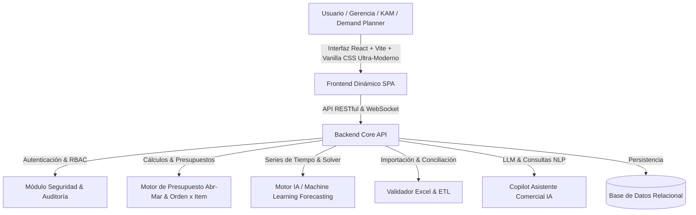
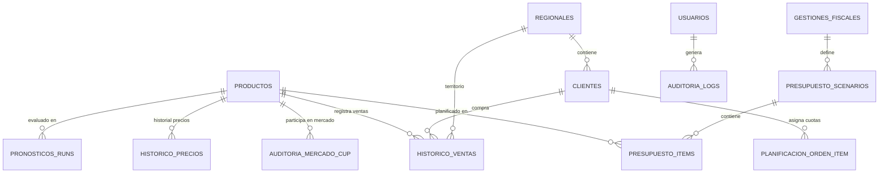

# Arquitectura del Sistema ERP Comercial Pharma & Forecasting IA
**Plataforma Empresarial de Planificación Comercial, Presupuesto, Inteligencia de Mercado y Pronósticos**

---

## 1. Visión General del Sistema

El sistema sustituye las planillas Excel comerciales y de gestión farmacéutica por una plataforma web empresarial dinámica, reactiva y multiusuario. Integra modelos de pronósticos avanzados (Holt-Winters, SES, optimización tipo Solver de parámetros $\alpha, \beta, \phi$), gestión presupuestaria por ciclo fiscal farmacéutico (**Gestión Abril - Marzo**), analítica Retail / CUP y un asistente conversacional IA para la toma de decisiones gerenciales.



---

## 2. Pila Tecnológica (Tech Stack)

| Capa | Tecnología | Justificación |
|---|---|---|
| **Frontend** | **React + Vite** + **Vanilla CSS moderno** (Design System con Glassmorphism, Paleta HSL Farmacéutica, Micro-animaciones) | Máxima reactividad, renderizado dinámico de tablas matriciales (12 meses fiscales), tableros interactivos y gráficos SVG/Canvas sin lags. |
| **Gráficos & Visualización** | **Chart.js** / **ApexCharts** + Custom KPI widgets | Visualizaciones interactivas de series temporales, presupuesto vs real, participación de mercado y dispersión de errores. |
| **Backend API** | **FastAPI (Python)** / **Node.js Express Modular** | FastAPI permite ejecutar directamente bibliotecas numéricas (`numpy`, `scipy.optimize` para el Solver de $\alpha, \beta, \phi$) y procesar series de tiempo con máxima velocidad. |
| **Motor de Pronósticos** | **Python (NumPy, SciPy)** / Motor Nativo de Optimización | Implementación exacta de Naive, SMA, WMA, Suavización Exponencial Simple, Holt Linear, Holt-Winters (Aditivo/Multiplicativo) y optimizador Nelder-Mead / L-BFGS-B para sustituir Excel Solver. |
| **Base de Datos** | **PostgreSQL** (o SQLite embebido para entorno local ágil) | Integridad referencial estricta, consultas agregadas de ventas históricas, soporte para JSON de auditoría y particionamiento por gestión fiscal. |
| **Procesador Excel** | **OpenPyXL / SheetJS (XLSX)** | Lectura, validación de fórmulas, conciliación celda por celda contra el Excel original y exportación estilizada a Excel y PDF. |
| **IA Copilot** | **Módulo LLM Integrado** con Contexto Semántico y Agregaciones SQL | Respuestas en lenguaje natural sobre desvíos de presupuesto, productos bajo riesgo, sugerencias de precios y metas de crecimiento. |

---

## 3. Modelo de Base de Datos Relacional

### 3.1. Diagrama Entidad-Relación (ERD)



### 3.2. Diccionario de Tablas Principales

#### A. Maestro de Productos (`productos`)
- `id` (PK, UUID/Int)
- `codigo` (VARCHAR, Unique - Código SKU/SAP)
- `nombre` (VARCHAR - Nombre comercial)
- `linea` (VARCHAR - Ej: Éticos, Genéricos, OTC, Hospitalaria)
- `categoria` (VARCHAR - Categoría terapéutica)
- `forma_farmaceutica` (VARCHAR - Comprimidos, Jarabe, Inyectable, etc.)
- `core` (BOOLEAN - Si es producto estratégico CORE)
- `molecula` (VARCHAR - Principio activo / DCI)
- `presentacion` (VARCHAR - Ej: Caja x 30 comp, Frasco 120ml)
- `clase_terapeutica_atc` (VARCHAR - Código ATC / Clase de mercado)
- `precio_base_actual` (DECIMAL(12,2))
- `costo_base` (DECIMAL(12,2))
- `activo` (BOOLEAN)

#### B. Territorios & Clientes (`regionales`, `clientes`, `territorios`)
- `regionales`: `id`, `codigo`, `nombre` (Ej: La Paz, Santa Cruz, Cochabamba, etc.), `responsable`.
- `clientes`: `id`, `codigo_erp`, `nombre_razon_social`, `canal` (Cadenas, Independientes, Instituciones), `regional_id` (FK), `tipo_cliente`.

#### C. Ventas Históricas (`historico_ventas`)
- `id` (PK)
- `producto_id` (FK)
- `cliente_id` (FK)
- `regional_id` (FK)
- `anio` (INT)
- `mes` (INT: 1 al 12)
- `cantidad` (DECIMAL(12,2))
- `precio_unitario` (DECIMAL(12,2))
- `importe_neto` (DECIMAL(14,2) = `cantidad * precio_unitario`)
- `fuente_archivo` (VARCHAR - Nombre del Excel importado)
- `created_at` (TIMESTAMP)

#### D. Presupuesto Comercial & Ciclo Fiscal (`gestiones_fiscales`, `presupuesto_escenarios`, `presupuesto_items`)
- **Gestión Fiscal**: `id`, `nombre` (Ej: "Gestión 2026-2027"), `fecha_inicio` (01/04), `fecha_fin` (31/03).
- **Escenarios**: `id`, `gestion_id` (FK), `tipo_escenario` (`HISTORICO`, `REAL`, `PROYECTADO`, `OFICIAL`, `MODIFICADO`), `version`, `aprobado` (BOOLEAN).
- **Items Presupuesto**:
  - `id`
  - `escenario_id` (FK)
  - `producto_id` (FK)
  - `regional_id` (FK)
  - `mes_fiscal` (INT: 1=Abril, 2=Mayo, ..., 12=Marzo)
  - `cantidad_presupuestada` (DECIMAL)
  - `precio_presupuestado` (DECIMAL)
  - `valorizacion` (DECIMAL = `cantidad * precio`)
  - `crecimiento_pct` (DECIMAL vs año anterior)

#### E. Planificación por Cliente y Producto (`planificacion_orden_item`)
- `id`
- `gestion_id` (FK)
- `cliente_id` (FK)
- `producto_id` (FK)
- `mes_fiscal` (1..12)
- `cantidad` (DECIMAL)
- `distribucion_tipo` (`HISTORICO_PONDERADO`, `PORCENTUAL_PERSONALIZADO`, `LINEAL`)
- `porcentaje_distribucion` (DECIMAL)

#### F. Motor de Forecasting & Solver IA (`modelos_pronostico_runs`)
- `id`
- `producto_id` (FK)
- `regional_id` (FK, Nullable)
- `periodo_corte` (DATE)
- `modelo_nombre` (`NAIVE`, `SMA_3`, `SMA_6`, `WMA`, `SES`, `HOLT_LINEAR`, `HOLT_WINTERS_ADD`, `HOLT_WINTERS_MUL`)
- `param_alpha` (DECIMAL - Nivel)
- `param_beta` (DECIMAL - Tendencia)
- `param_gamma_phi` (DECIMAL - Estacionalidad / Amortiguación)
- `metrica_mad` (DECIMAL - Desviación Media Absoluta)
- `metrica_rmse` (DECIMAL - Raíz del Error Cuadrático Medio)
- `metrica_mape` (DECIMAL - Error Porcentual Absoluto Medio)
- `precision_pct` (DECIMAL = `100 - MAPE`)
- `es_mejor_modelo` (BOOLEAN)
- `serie_pronostico_json` (JSON con los 12 meses proyectados)

#### G. Inteligencia de Mercado Retail & CUP (`auditoria_mercado_cup`)
- `id`, `periodo` (Mes/Año), `mercado`, `clase_terapeutica`, `molecula`, `laboratorio`, `marca`, `unidades_mercado`, `valores_mercado`, `market_share_unidades`, `market_share_valores`, `indice_evolucion`.

#### H. Gestión de Precios & Simulación (`gestion_precios`, `historico_cambios_precios`)
- `id`, `producto_id` (FK), `precio_anterior`, `precio_nuevo`, `fecha_vigencia`, `elasticidad_estimada`, `impacto_volumen_pct`, `impacto_facturacion_monetaria`, `justificacion`, `usuario_id` (FK).

#### I. Seguridad, Roles y Auditoría (`usuarios`, `roles`, `auditoria_logs`)
- `usuarios`: `id`, `nombre`, `email`, `password_hash`, `rol` (`ADMIN`, `GERENTE_COMERCIAL`, `PLANIFICADOR_DEMANDA`, `KAM_REGIONAL`, `AUDITOR`), `regional_id`.
- `auditoria_logs`: `id`, `usuario_id`, `modulo`, `accion` (`INSERT`, `UPDATE`, `DELETE`, `IMPORT_EXCEL`, `SOLVER_RUN`), `detalles_json`, `ip_address`, `timestamp`.

---

## 4. Arquitectura de Pantallas y Experiencia de Usuario (UI/UX Dinámica)

La aplicación implementa una interfaz moderna con navegación lateral fluida, tarjetas de métricas reactivas, tablas con edición rápida, filtros globales sincronizados en tiempo real y gráficos dinámicos:

```
+----------------------------------------------------------------------------------------------------+
|  [LOGO PHARMA ERP]   |  Filtros Globales: [Gestión: 2026-2027 v] [Regional: Todas v] [Línea: Todas v] [Usuario: Admin] |
+----------------------------------------------------------------------------------------------------+
|  SIDEBAR               |  CONTENEDOR DINÁMICO (Vistas Modulares)                                  |
|  -------------------   |                                                                          |
|  📊 1. Dashboard       |  [KPIs: Presupuesto | Ventas Reales | Cumplimiento % | Crecimiento YoY]  |
|     Gerencial          |  [Gráfico: Ventas vs Presupuesto vs Forecast 12 Meses Fiscales]           |
|  💊 2. Catálogo        |  [Top 10 Productos Valorizados] [Desempeño por Regional y Línea]        |
|     Productos & CORE   |                                                                          |
|  🗺️ 3. Territorios     |  ----------------------------------------------------------------------  |
|     & Clientes         |  TABLE / GRID DINÁMICA:                                                  |
|  📈 4. Histórico       |  - Edición en línea / simulación en tiempo real                         |
|     Ventas & ETL       |  - Desglose mensual Abr -> Mar con totales automáticos                  |
|  💰 5. Presupuesto     |  - Barra de estado, alertas de variación y semáforos                      |
|     Gestión Fiscal     |                                                                          |
|  📦 6. Planificación   |  ----------------------------------------------------------------------  |
|     Orden x Item       |  PANEL LATERAL / MODAL:                                                  |
|  🤖 7. Forecast &      |  - 🤖 Asistente IA Integrado (Consultas NLP y Diagnósticos)              |
|     Solver IA          |  - ⚙️ Optimizador Solver (Alpha, Beta, Phi) en vivo                      |
|  🔬 8. Inteligencia    |  - 📥 Importador/Validador Excel con mapeo visual y diffs               |
|     Retail & CUP       |  - 📄 Exportador Instantáneo a Excel / PDF                               |
|  💲 9. Gestión         |                                                                          |
|     de Precios         |                                                                          |
|  📑 10. Reportes &     |                                                                          |
|     Auditoría          |                                                                          |
+----------------------------------------------------------------------------------------------------+
```

### Detalle de Módulos:

1. **Dashboard Gerencial Interactivo**:
   - KPIs en tiempo real con micro-gráficos sparkline.
   - Selector dinámico de año, gestión fiscal (Abr-Mar), regional, producto, línea y cliente.
   - Comparativo trifásico: Presupuesto Oficial vs. Venta Real vs. Forecast Proyectado.
   - Matriz de productos CORE vs. Non-CORE y ranking de clientes.

2. **Administración de Productos & Maestro Farmacéutico**:
   - Catálogo interactivo con filtros facetados por Línea, Categoría, Forma Farmacéutica, Molécula, Presentación y bandera CORE.
   - Búsqueda instantánea, alta/edición y estado de cada producto.

3. **Gestión de Regionales, Clientes y Territorios**:
   - Mapeo de clientes por regional (La Paz, Santa Cruz, Cochabamba, Chuquisaca, etc.).
   - Clasificación por canal de venta (Cadenas, Independientes, Instituciones).

4. **Histórico de Ventas & Importador Excel Inteligente con Validación**:
   - Carga masiva de archivos `.xlsx` y `.csv`.
   - Conciliación y chequeo de integridad: valida códigos SKU existentes, totales por mes y reporta diferencias antes de confirmar la carga.
   - Explorador de datos históricos con ordenamiento y paginación rápida.

5. **Módulo de Presupuesto Comercial por Gestión (Abril - Marzo)**:
   - Vista tabular matricial de los 12 meses del ciclo fiscal farmacéutico.
   - Conmutador instantáneo de escenarios: `Histórico`, `Real`, `Proyectado`, `Oficial`, `Modificado`.
   - Cálculo automático de variaciones porcentuales, crecimiento y valorizaciones.

6. **Planificación Cliente x Producto (Orden x Item)**:
   - Distribución automática de cantidades mensuales según pesos históricos estacionales o curvas porcentuales predefinidas.
   - Ajuste manual interactivo con rebalanceo automático.

7. **Motor de Pronósticos con IA (AutoML Time Series)**:
   - Cálculo simultáneo de 7 modelos: Naive, SMA (3m, 6m), WMA, Suavización Exponencial Simple, Holt Linear, Holt-Winters Aditivo y Multiplicativo.
   - Tablero comparativo de métricas: MAD, RMSE, MAPE y Precisión %.
   - **Algoritmo de Selección Automática**: Identifica y aplica el modelo óptimo con menor error por producto.

8. **Optimizador Inteligente (Solver IA)**:
   - Reemplaza el Solver de Excel buscando automáticamente los mejores valores para $\alpha$ (nivel), $\beta$ (tendencia) y $\phi / \gamma$ (amortiguación/estacionalidad) mediante optimización matemática restringida en el rango $[0, 1]$.
   - Gráfico de convergencia del error y comparativa antes/después del Solver.

9. **Inteligencia de Mercado (Análisis Retail y CUP)**:
   - Análisis de auditoría farmacéutica: Tamaño de mercado, clases terapéuticas (ATC), moléculas clave.
   - Métricas de Market Share en unidades y valores, e Índice de Evolución (IE).

10. **Gestión de Precios & Análisis de Impacto Económico**:
    - Simulador interactivo: modificar precio actual $\rightarrow$ calcular elasticidad, variación de volumen e impacto proyectado en facturación y margen.
    - Bitácora de histórico de cambios de precio con justificación y usuario responsable.

11. **Reportes Automáticos y Exportador Excel/PDF**:
    - Reportes preconfigurados por Producto, Regional, Cliente, Presupuesto, Forecast y Mercado.
    - Exportación a Excel con fórmulas y estilos, y a PDF para comités gerenciales.

12. **Asistente IA Copilot Comercial**:
    - Chatbot analítico interactivo empotrado en la aplicación.
    - Capacidad para responder: *"¿Cuáles productos están más del 15% por debajo del presupuesto en Santa Cruz?", "¿Qué impacto tiene subir 5% el precio del producto CORE X?", "¿Generar propuesta de presupuesto 2026-2027 con crecimiento del 8%?"*

13. **Seguridad, Roles, Auditoría & Respaldos**:
    - Control de acceso basado en roles (RBAC).
    - Registro inmutable de cada cambio (quién cambió qué cantidad o precio, fecha y hora).
    - Opción de Backup y Restauración de datos con un clic.

---

## 5. Fases de Desarrollo Paso a Paso

1. **Fase 1: Fundación y Core Dinámico (Frontend + Estado + Modelos)**
   - Estructura del proyecto con Vite + React + Vanilla CSS de alta fidelidad.
   - Motor de estado reactivo local con persistencia y datos maestros iniciales (Productos pharma reales, clientes, regionales, histórico de ventas).
   - Componentes base: Layout empresarial, navegación, filtros universales y notificaciones.

2. **Fase 2: Dashboard Gerencial + Catálogos Maestros**
   - Tablero principal interactivo con KPIs, gráficos y filtros cruzados.
   - Módulo de Productos (CORE, moléculas, formas farmacéuticas), Regionales y Clientes.

3. **Fase 3: Módulo de Ventas Históricas + Importador/Validador Excel**
   - Tabla dinámica de ventas con importación directa de Excel `.xlsx`.
   - Conciliador con cálculo de sumas de control y validación de SKU.

4. **Fase 4: Presupuesto Gestión Fiscal (Abril - Marzo) + Orden x Item**
   - Matriz presupuestaria de 12 meses con escenarios (Histórico, Real, Proyectado, Oficial, Modificado).
   - Algoritmo de distribución estacional Orden x Item por cliente.

5. **Fase 5: Motor de Forecasting IA + Optimizador Solver**
   - Implementación de los 7 modelos de series temporales (Naive, SMA, SES, Holt, Holt-Winters).
   - Cálculo de MAD, RMSE, MAPE y selector automático del mejor modelo.
   - Algoritmo Solver de optimización de parámetros ($\alpha, \beta, \phi$).

6. **Fase 6: Inteligencia de Mercado Retail/CUP + Simulador de Precios**
   - Matriz CUP, análisis de moléculas y Market Share.
   - Simulador de impacto de precios y elasticidad económica.

7. **Fase 7: Asistente IA Copilot + Reportes Excel/PDF + Seguridad & Auditoría**
   - Asistente IA conversacional integrado.
   - Exportador a Excel y PDF con formato corporativo.
   - Control de usuarios, roles, log de auditoría y respaldo.
